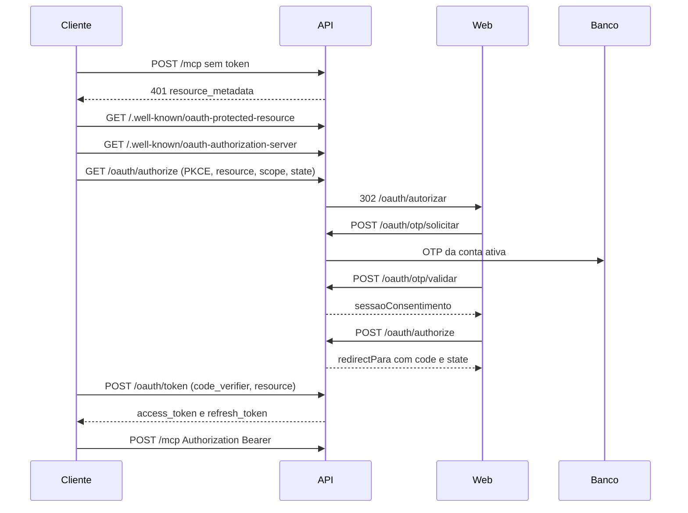

# OAuth 2.1 do canal MCP

Authorization Code com PKCE S256, cliente público (`token_endpoint_auth_method: none`) e OTP do ChekAI. Os endpoints ficam na raiz do host da API, não em `/api`.

## Variáveis

| Variável | Desenvolvimento, se omitida | Produção (`NODE_ENV=production`) |
|----------|------------------------------|----------------------------------|
| `FRONTEND_URL` | obrigatória também em dev | obrigatória, sem barra final |
| `MCP_PUBLIC_URL` | `http://localhost:3001` | obrigatória, sem barra final |
| `OAUTH_ISSUER` | o valor de `MCP_PUBLIC_URL` | obrigatória, sem barra final |
| `OAUTH_ACCESS_TOKEN_TTL` | `3600` (1 hora) | obrigatória, inteiro positivo, em segundos |
| `OAUTH_REFRESH_TOKEN_TTL` | `1209600` (14 dias) | obrigatória, inteiro positivo, em segundos |
| `OAUTH_JWT_SECRET` | `dev-oauth-mcp-key` | obrigatória e diferente de `JWT_SECRET` |

Se faltar valor, se o TTL não for inteiro positivo, ou se `OAUTH_JWT_SECRET` for igual a `JWT_SECRET`, `OauthConfigService` impede a subida com `Configuração OAuth inválida: ...`.

`OAUTH_ISSUER` é o claim `iss` e o item `authorization_servers` do metadata do recurso. Os endpoints (`authorization_endpoint`, `token_endpoint`, `revocation_endpoint`, `registration_endpoint`) são montados com `MCP_PUBLIC_URL`. No deploy de um único host, use o mesmo valor nos dois, por exemplo `https://api.chekai.com.br`. Um issuer em outro host só funciona se esse host também publicar `/.well-known/oauth-authorization-server` desta API; o Nest não sobe um segundo servidor de metadata.

## Discovery

`GET /.well-known/oauth-protected-resource`

```json
{
  "resource": "https://api.chekai.com.br/mcp",
  "authorization_servers": ["https://api.chekai.com.br"],
  "bearer_methods_supported": ["header"],
  "scopes_supported": ["chekai:contexto"]
}
```

A lista real de `scopes_supported` é a de [scopes](#scopes). O exemplo acima está abreviado.

`GET /.well-known/oauth-authorization-server`

- `issuer`
- `authorization_endpoint`: `{MCP_PUBLIC_URL}/oauth/authorize`
- `token_endpoint`: `{MCP_PUBLIC_URL}/oauth/token`
- `revocation_endpoint`: `{MCP_PUBLIC_URL}/oauth/revoke`
- `registration_endpoint`: `{MCP_PUBLIC_URL}/oauth/register`
- `response_types_supported`: `code`
- `grant_types_supported`: `authorization_code`, `refresh_token`
- `code_challenge_methods_supported`: `S256`
- `token_endpoint_auth_methods_supported`: `none`

Os dois documentos usam `Cache-Control: public, max-age=300`.

`POST /mcp` sem `Authorization: Bearer` responde 401:

```http
WWW-Authenticate: Bearer error="invalid_token", resource_metadata="https://api.chekai.com.br/.well-known/oauth-protected-resource"
```

O corpo é `{ "error": "invalid_token" }`. O handler MCP não abre.

## Clientes

O caminho preferido é Client ID Metadata Document: `client_id` é uma URL `https://` sem usuário nem senha. A API faz GET nesse URL (timeout 5s, corpo até 64 KiB, sem seguir redirect) e exige `redirect_uris`. Se o documento trouxer `client_id`, ele tem de ser igual à URL buscada.

`POST /oauth/register` existe só como fallback. Exige `redirect_uris` http(s) sem fragmento e devolve um `client_id` UUID, não uma URL. Não há client secret.

A `redirect_uri` da autorização tem de ser igual, caractere a caractere, a uma URI cadastrada.

## Fluxo



Pedido mínimo de autorização: `response_type=code`, `client_id`, `redirect_uri`, `code_challenge`, `code_challenge_method=S256`, `resource={MCP_PUBLIC_URL}/mcp`, `scope` com um ou mais scopes operacionais separados por espaço, e `state`.

Troca do code (`grant_type=authorization_code`): `code`, `redirect_uri`, `code_verifier`, `resource` e `client_id`. Resposta:

```json
{
  "access_token": "<jwt>",
  "token_type": "Bearer",
  "expires_in": 3600,
  "refresh_token": "<opaco>",
  "scope": "chekai:contexto chekai:clientes:ler"
}
```

Claims do JWT, assinados com HS256 e `OAUTH_JWT_SECRET`: `iss`, `sub`, `aud`, `resource`, `scope`, `perfil`, `jti`, `iat`, `exp`. `aud` e `resource` são o endpoint MCP. `perfil`, `gestorId` e `tenantId` são relidos do banco a cada requisição; o claim `perfil` não autoriza sozinho.

Renovação (`grant_type=refresh_token`) gira o refresh: o anterior fica usado e um par novo é emitido. Reapresentar um refresh já usado revoga a concessão inteira (refresh e access da família).

`POST /oauth/revoke` com `{ "token": "<access ou refresh>" }` revoga a concessão. Token desconhecido responde 200 e não altera nada.

## Scopes

São os únicos aceitos na autorização. Scope desconhecido recusa o pedido. A tela de consentimento mostra somente os solicitados que estejam nesta lista.

| Scope | Tools |
|-------|--------|
| `chekai:contexto` | `chekai_me` |
| `chekai:clientes:ler` | `chekai_listar_clientes`, `chekai_obter_cliente`, `chekai_listar_unidades` |
| `chekai:checklists:ler` | `chekai_listar_checklists`, `chekai_obter_checklist` |
| `chekai:auditorias:ler` | `chekai_listar_auditorias`, `chekai_obter_auditoria` |
| `chekai:auditorias:escrever` | `chekai_iniciar_auditoria`, `chekai_responder_item` |
| `chekai:auditorias:finalizar` | `chekai_preparar_finalizacao`, `chekai_finalizar_auditoria` |
| `chekai:agenda:ler` | `chekai_listar_agenda` |
| `chekai:agenda:concluir` | `chekai_concluir_agendamento` |
| `chekai:tarefas:ler` | `chekai_listar_tarefas` |
| `chekai:tarefas:escrever` | `chekai_criar_tarefa`, `chekai_atualizar_tarefa`, `chekai_concluir_tarefa`, `chekai_reabrir_tarefa` |
| `chekai:relatorios:ler` | `chekai_listar_relatorios`, `chekai_obter_relatorio` |
| `chekai:relatorios:escrever` | `chekai_iniciar_relatorio`, `chekai_atualizar_relatorio` |
| `chekai:relatorios:finalizar` | `chekai_preparar_finalizacao_relatorio`, `chekai_finalizar_relatorio` |

`tools/list` devolve a interseção de perfil e scopes. `tools/call` sem o scope da tool responde HTTP 403, sem executar o handler:

```http
WWW-Authenticate: Bearer error="insufficient_scope", error_description="Insufficient scope", scope="chekai:clientes:ler", resource_metadata="https://api.chekai.com.br/.well-known/oauth-protected-resource"
```

MASTER, GESTOR e AUDITOR podem receber as 25 tools. O recorte dos dados continua nos services de domínio. O modelo não envia `gestorId`, `tenantId` nem `consultorId`.

## O que fica persistido

O script `scripts/criar-tabelas-oauth-mcp.sql` cria `oauth_clientes`, `oauth_sessoes_consentimento`, `oauth_authorization_codes`, `oauth_concessoes`, `oauth_refresh_tokens` e `oauth_access_tokens`. Código, access e refresh são guardados só como SHA-256. O token de confirmação de finalização não vai ao banco: fica na memória do processo por no máximo 10 minutos. Ver [seguranca.md](./seguranca.md).
